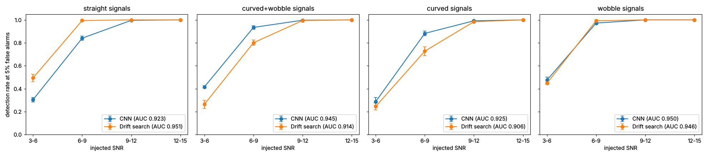
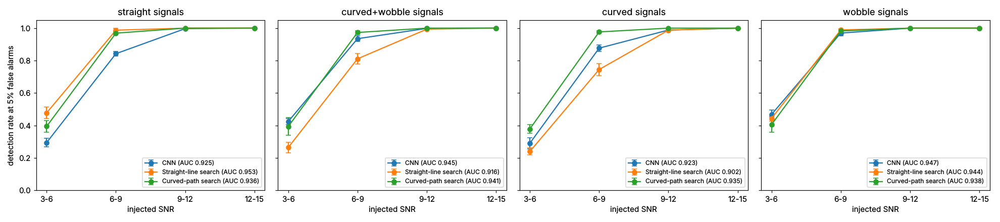

# SETI Narrowband Signal Detection: Classical Search vs. Machine Learning

An undergraduate research project exploring how well a standard SETI search
algorithm detects faint drifting radio signals, and whether a small neural
network can do better.

**Status:** in progress. All results so far are on simulated data.

## Key findings so far
- On simple **straight** drifting signals, a classical straight-line drift
  search (the core idea behind `turbo_seti`) beats a small CNN
  (ROC AUC 0.951 vs. 0.923), even with 10,000 training frames.
- On signals whose **path bends**, the CNN beats that same search
  (AUC 0.945 vs. 0.916 for curved, wobbling signals), in all 5 of 5 seeds.
- But a classical search that **also tries curved paths** closes almost all
  of that gap: it beats the CNN on curved signals (AUC 0.935 vs. 0.923) and
  is nearly tied with it on curved, wobbling ones (0.941 vs. 0.945).
  So far the CNN has not clearly beaten a classical search that knows
  what shape the signal has.
- **Brightness changes alone** do not help the CNN: with a straight path,
  all three methods are about even.
- The CNN needs its depth: cutting it to 1 or 2 conv layers hurts the most;
  halving its width barely matters.
- Next question: how do these methods hold up on real telescope noise?

## Background
SETI searches look for narrowband radio signals that drift in frequency
because of the Doppler effect. Breakthrough Listen's `turbo_seti` is a
standard tool for finding them. Very faint signals are hard to separate from
random noise: set the detection threshold too high and real signals are
missed, set it too low and noise triggers false alarms.

## What's done so far
1. **Real data:** loaded Breakthrough Listen's Voyager 1 observation with
   `blimpy` and plotted its carrier and sidebands.
2. **Classical search:** ran `turbo_seti` on that file and recovered the
   carrier (drift of about -0.38 Hz/s, SNR of about 246).
3. **Controlled test bench:** injected fake signals with known drift and SNR
   into noise using `setigen`, then checked what `turbo_seti` recovers.
   - With the search threshold at SNR 10, signals injected at SNR 9 and above
     were found, and weaker ones were not (single trial per setting).
   - Lowering the threshold to 5 produced a large number of false hits from
     noise.
4. **ML dataset:** generated 3,000 labeled spectrograms (half with a hidden
   drifting signal, half noise only) with random SNR from 3 to 15.
5. **ML model:** trained a small convolutional network (3 conv layers,
   15 epochs) to classify them. On a held-out test set of 600 spectrograms
   (20% of the data, never used in training) it reached about 85% accuracy.

   The network outputs a probability that a signal is present; the
   **cutoff** is the probability above which we call it a detection.
   Raising the cutoff trades sensitivity for fewer false alarms.
   **False alarms** is the fraction of the 300 noise-only test examples
   flagged as signals; the **SNR** columns are the fraction of injected
   signals detected in each SNR range (62, 83 and 70 signals respectively).
   At the default cutoff of 0.5, all 85 signals with SNR 12-15 were detected.
   Single training run, so these numbers are preliminary.

   | Cutoff | False alarms | SNR 3-6 | SNR 6-9 | SNR 9-12 |
   |-------:|-------------:|--------:|--------:|---------:|
   | 0.3    | 18.3%        | 50%     | 88%     | 100%     |
   | 0.5    | 8.7%         | 29%     | 76%     | 100%     |
   | 0.7    | 3.3%         | 16%     | 63%     | 97%      |
   | 0.9    | 0.3%         | 6%      | 53%     | 89%      |

6. **Fair classical baseline:** comparing the CNN to `turbo_seti` directly
   was not like for like (different file sizes and thresholds). So I wrote a
   small drift search that runs on the same 32×256 test frames the CNN sees.
   It adds up the power along every straight drift line through the frame
   (covering the full injected drift range) and keeps the strongest one,
   which is the core idea behind `turbo_seti`.

   Both methods give one score per frame, so sweeping a cutoff over each
   gives an ROC curve (detection rate vs. false alarm rate). For a per-SNR
   comparison, each method's cutoff is set so that both flag exactly 5% of
   the 300 noise-only test frames:

   | Method       | ROC AUC | SNR 3-6 | SNR 6-9 | SNR 9-12 | SNR 12-15 |
   |--------------|--------:|--------:|--------:|---------:|----------:|
   | CNN          | 0.924   | 21%     | 77%     | 96%      | 100%      |
   | Drift search | 0.953   | 45%     | 96%     | 100%     | 100%      |

   **The simple drift search beats the CNN**, and the gap is largest for
   faint signals: at SNR 3-6 it finds about twice as many. A separate test
   run gave the same picture (AUC 0.950 vs. 0.927). This is not surprising:
   the synthetic signals are perfectly straight lines in plain noise, which
   is exactly the case summing along straight lines is built for. For the
   CNN to be worth using, it probably needs data where that assumption
   breaks down.

   Note: these early numbers came from unseeded runs, so they varied from
   run to run, and the cutoff table above and this comparison come from
   different runs. The notebook is now seeded, and item 7 below repeats
   the comparison more carefully.

7. **Larger, repeated comparison on harder signals:** redid the comparison
   with 10,000 training frames, longer training (best epoch kept on a
   validation set), 3 seeds, and 5% cutoffs set on a separate set of
   noise-only frames, so the test frames are never used to tune anything.
   Then repeated it for signals the straight-line search was not built for:
   paths that bend (**curved**), brightness that swings ±60% around its
   average (**wobble**), and both. Each test set has 2,000 frames.
   Numbers are the mean ± spread over the 3 seeds; detection rates are at
   a matched 5% false alarm rate.

   | Signals       | Method       | ROC AUC       | SNR 3-6     | SNR 6-9     |
   |---------------|--------------|---------------|-------------|-------------|
   | Straight      | CNN          | 0.923 ± 0.008 | 31% ± 2     | 84% ± 2     |
   |               | Drift search | 0.951 ± 0.004 | 49% ± 3     | 100% ± 1    |
   | Curved+wobble | CNN          | 0.945 ± 0.004 | 42% ± 1     | 93% ± 2     |
   |               | Drift search | 0.914 ± 0.009 | 26% ± 4     | 80% ± 2     |
   | Curved only   | CNN          | 0.925 ± 0.006 | 29% ± 4     | 88% ± 2     |
   |               | Drift search | 0.906 ± 0.010 | 25% ± 3     | 73% ± 4     |
   | Wobble only   | CNN          | 0.950 ± 0.004 | 48% ± 3     | 97% ± 2     |
   |               | Drift search | 0.946 ± 0.003 | 45% ± 1     | 99% ± 1     |

   Above SNR 9 both methods find essentially every signal.

   

   What this shows:
   - **Straight signals:** the drift search still clearly wins, even with
     4× more training data. So the CNN's earlier loss was not just
     undertraining.
   - **Curved signals:** the CNN wins, by a margin well outside the
     seed-to-seed spread, mostly at SNR 6-9.
   - **Wobble only:** the two are about even. Brightness changes alone
     do not hurt a search that adds up power along the whole line;
     **the bending path is what breaks the straight-line assumption.**

   Caveats: the baseline is a *straight-line* search like `turbo_seti`, so
   this shows the CNN beats the standard search, not every classical
   method; item 8 adds a search that also tries curved paths. The straight runs used a wider drift range (±0.3 Hz/s) than
   the others (±0.2 Hz/s), so compare the curved and wobble rows with each
   other rather than with the straight rows. These numbers came from a CPU
   run; a GPU run of the same seeded notebook may differ very slightly.
   The notebook now runs the 5-seed version of this comparison in item 8,
   so its numbers replace these.

8. **Curved-path search, CNN ablation and 5 seeds:** to check whether the
   CNN's win on bending signals holds up against a stronger classical
   method, I added a **curved-path search**. It tries every straight drift
   line *and* every version of it bent by up to ±9 channels at its
   midpoint, which covers the bends in the simulated signals. With the bend
   set to zero it gives exactly the same scores as the straight-line
   search. Everything was rerun with 5 seeds instead of 3, and each seed
   uses the same test frames for all methods, so the methods can be
   compared seed by seed.

   | Signals       | Method               | ROC AUC       | SNR 3-6 | SNR 6-9 |
   |---------------|----------------------|---------------|--------:|--------:|
   | Straight      | CNN                  | 0.925 ± 0.007 | 29% ± 3 | 84% ± 2 |
   |               | Straight-line search | 0.953 ± 0.005 | 48% ± 4 | 99% ± 1 |
   |               | Curved-path search   | 0.936 ± 0.005 | 39% ± 3 | 97% ± 1 |
   | Curved+wobble | CNN                  | 0.945 ± 0.005 | 42% ± 2 | 94% ± 2 |
   |               | Straight-line search | 0.916 ± 0.008 | 26% ± 3 | 81% ± 3 |
   |               | Curved-path search   | 0.941 ± 0.005 | 39% ± 6 | 97% ± 1 |
   | Curved only   | CNN                  | 0.923 ± 0.006 | 29% ± 3 | 88% ± 2 |
   |               | Straight-line search | 0.902 ± 0.011 | 24% ± 2 | 75% ± 4 |
   |               | Curved-path search   | 0.935 ± 0.007 | 38% ± 3 | 98% ± 1 |
   | Wobble only   | CNN                  | 0.947 ± 0.006 | 47% ± 3 | 97% ± 2 |
   |               | Straight-line search | 0.944 ± 0.004 | 44% ± 2 | 99% ± 1 |
   |               | Curved-path search   | 0.938 ± 0.007 | 41% ± 5 | 98% ± 1 |

   Seed-by-seed AUC difference (CNN minus each search) and how many of the
   5 seeds the CNN came out ahead:

   | Signals       | vs. straight-line search | vs. curved-path search |
   |---------------|--------------------------|------------------------|
   | Straight      | −0.028 (0 of 5)          | −0.012 (0 of 5)        |
   | Curved+wobble | +0.030 (5 of 5)          | +0.004 (5 of 5)        |
   | Curved only   | +0.021 (5 of 5)          | −0.012 (0 of 5)        |
   | Wobble only   | +0.003 (3 of 5)          | +0.009 (4 of 5)        |

   

   What this shows:
   - **The curved-path search takes back most of the CNN's advantage.**
     On curved signals it beats the CNN in every seed, mainly at SNR 6-9
     (98% vs. 88%). On curved, wobbling signals the CNN has a slightly
     higher AUC in all 5 seeds, but the margin is tiny (+0.004), and at a
     5% false alarm rate the curved-path search actually finds more
     SNR 6-9 signals (97% vs. 94%).
   - **Trying more paths has a cost.** On straight signals the curved-path
     search is worse than the straight-line one (AUC 0.936 vs. 0.953),
     because with 19× more paths to choose from, noise is more likely to
     line up along one of them by chance.
   - So the CNN's earlier win came mostly from the straight-line search
     having the wrong template. A classical search with the right template
     is about as good as the CNN or better. The CNN's real advantage is
     that it was not told the signal shape; it learned it from examples.

   **Which parts of the network matter (ablation):** on curved, wobbling
   signals I also trained four cut-down versions of the CNN, with 5 seeds
   each:

   | CNN version                      | ROC AUC       | SNR 3-6 | SNR 6-9 |
   |----------------------------------|---------------|--------:|--------:|
   | Full (3 conv layers, max pooling) | 0.945 ± 0.005 | 42% ± 2 | 94% ± 2 |
   | Half as many filters             | 0.940 ± 0.004 | 42% ± 3 | 92% ± 2 |
   | Average instead of max pooling   | 0.937 ± 0.003 | 40% ± 2 | 92% ± 3 |
   | 2 conv layers                    | 0.929 ± 0.002 | 33% ± 3 | 88% ± 1 |
   | 1 conv layer                     | 0.884 ± 0.003 | 17% ± 3 | 66% ± 3 |

   - **Depth matters most.** Each conv layer removed costs a lot; with a
     single layer the CNN is worse than even the straight-line search.
     Stacking layers lets the network see a longer stretch of the signal
     at once, which a faint signal needs.
   - **Max pooling helps a little.** Taking the strongest response anywhere
     in the frame suits a signal that can sit anywhere; averaging dilutes
     it with all the empty noise.
   - **Width barely matters.** Half the filters lose only 0.005 AUC, so the
     network is not short of capacity.

   Caveats: the curved-path search was given the same kind of bend
   (a smooth arc) that the simulated signals have, so it is a best case
   for the classical method; real signals could bend in ways no fixed set
   of templates covers. The CNN's false alarm rate on curved+wobble came
   out slightly above 5% (6.1%), which flatters its detection rates a
   little. Per-seed numbers are in
   [`results/five_seed_results.csv`](results/five_seed_results.csv).

## Planned next steps
- Use real noise: inject signals into actual Breakthrough Listen data
  instead of simulated chi-squared noise.
- Anomaly detection: train a model on (real) noise only and flag anything
  that does not look like noise, with no signal template at all.

## Caveats
- All results so far use simulated chi-squared noise and simple signal
  shapes (fixed width; straight, curved or wobbling paths), so they do not
  necessarily carry over to real telescope data.
- The curved-path search assumes the same smooth bend the simulated
  signals have; it has not been tested on signals that change direction
  in other ways.
- Results come from 5 seeds, each with its own training data and network.
- `setigen` injected SNR and `turbo_seti` reported SNR are measured
  differently and are not directly interchangeable.

## Tools and data
- [Breakthrough Listen](https://seti.berkeley.edu/listen/) open data (UC Berkeley SETI Research Center)
- [blimpy](https://github.com/UCBerkeleySETI/blimpy), [turbo_seti](https://github.com/UCBerkeleySETI/turbo_seti), [setigen](https://github.com/bbrzycki/setigen)
- Python, PyTorch, NumPy, Matplotlib, Google Colab

## Running it
Open the notebook in Google Colab and run the first cell, which installs
dependencies and downloads the Voyager file (about 50 MB).

The larger experiments at the end of the notebook (items 7 and 8) train
40 models (4 signal types × 5 seeds, plus 4 cut-down CNNs × 5 seeds).
Switch to a GPU runtime first (Runtime → Change runtime type → T4 GPU).
They took about 2.3 hours on a 4-core CPU and would take many hours on
Colab's default CPU. For a quick check, set `SEEDS = [0]` first. The notebook is seeded, so a rerun should give nearly the
same numbers.

## Author
Sharvil Talware
